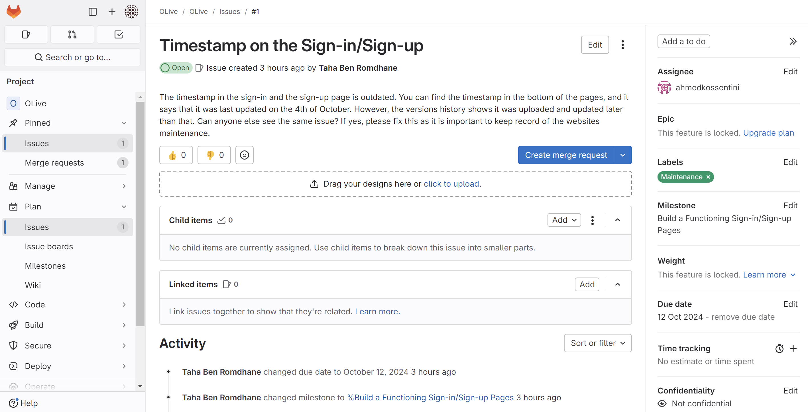
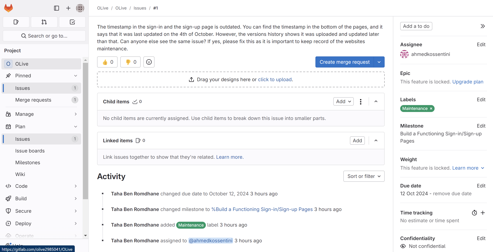

## OLive

OLive "Opportunities Live" is a website that provides users with scholarship opportunities posted by offering institutions. This website aims to bridge the gap between the youth and institutions, and therefore allowing the youth an opportunity to fulfill their potential despite financial constraints. The scholarships are generally offered to fund, in whole or in part, a higher education for youth all over the world. Offering institutions can be both educational e.g. universities, or professional e.g. firms. The genisis of the idea behind this website was to build a live scholarships hub, where youth can easily find and have access to scholarship opportunities internationally.

This project contains the source code for this website.

The canonical URL for this project is at https://gitlab.com/olive2985041/OLive

## Linux* Operating Systems (64-bit)


## Installation
- Please follow the following steps to be able to use OLive :
- __1. Build and Install OLive__
``` bash
git clone https://gitlab.com/olive2985041/OLive.git
cd OLive
```
- __2. Checking out to a specific branch: (optional)__
``` bash 
git checkout <branch_name>
``` 

## Usage

- __1. Front-End:

Please open the signin and signup html codes using visual studio code.
Open the images folder as it will give the code access to use the background 
wallpaper opened in the code.
Download the extansion Live Server, and then right click in the codes page.
Select open with live server.
Voila! you can see the sign in and sign up page and interact with them.
note : Opening one page using live server is enough to get to the other one,
but for an overall experience open both.

## Support
- <khalilo.khema@gmail.com>
- <ahmedkoss56@gmail.com>
- <anshdhaliwal6@gmail.com>
- <meekaljiwani1@gmail.com>
- <tbenromdhane14@gmail.com>

## Authors and acknowledgment
A big thank you to the following people who have contributed to this project:

- Ahmed Kossentini 
- Taha Ben Romdhane
- Khalil Khemakhem
- Ansh Dhaliwal
- Meekal Jiwani

## Project status

This project is still under development. Development is currently in progress, future updates will be made to finilize the development of the OLive and make sure it works perfectly. Contributions and suggestions are welcome.


## Retrospective Notes

**Front-end:**

What Went Right:
- Successfully created a good design for the website and implemented it.

Challenges:
- A fundamental contradiction between the front-end design that we implemented, and the database is that: front-end design and implementation assumed that the first step is choosing student or institution and then you get to fill the sign-up forms.
However, the database assumed that the common areas such as name, password, and email would be filled first and then you get to the part where you choose student or institution. Therefore, the linking was confusing. The issue was later solved by restructuring the database.


**Back-end:**

What Went Right:
- The way the database was structured is as follows, we tried to keep the “users” table in the schema as it’s very crucial and to have a user ID is totally helpful to have smooth Data adding or retrieving. 
Then, through the interaction with the sign-up page, the user will click on either “student”, Or “institution”. At that point, the role attribute will be filled in the “users” table, and it gets him directly to the intended table in order to start filling some uncommon data, compared to the other type of user, on that user which is originally related to the user ID. 
- Set Up Jira, added team members, explained how it works, and added timeline, backlog, and tasks to our SprintStarted testing the database. Made appropriate files an reorganized everything. Also had a meeting to discuss further steps.
- Figured out a proper testing structure, prioritizing efficiency, durability, integrity and security of the database.
- Improved testing code by fixing bugs and structure issues, 
- Completed debugging of the test scripts
- Completed database testing
- Created a couple of logos with the help of Canva and Photopea.
- I hand drew many logos with a purpose to create more ideas in finding our “perfect” logo.
- Submitted my logo ideas to Jira so team members could see them and give more feedback.
- Started working on the sign-in page and API testing


Challenges:
- When linking the sign-in/ sign-up pages with the database, we used XAMPP as we were looking for something that tests the behavior of the database and how it reacts with any added user or any user fetching. Also, in the iteration 1, developers found problem with linking the Database because we didn’t have a server. So, I found that XAMPP, would be a great solution as it creates a whole local environment on your computer that mimics a live server. Consequently, I can make a demo on how the sign-in/sign-up is reacting with my Database, and it helps our HTML front-end to interact with my PHP scripts on the Apache server, which process form of submissions and communicate with the database.
- Had to resolve a lot of script writing issues, with fixing the structure and mirrors errors costing a lot of time.
- Had to structure few files to be simpler to read and understand while keeping the integrity of the testing. 
- Had to study more and find better ways of testing, costing time and effort.
- Had to scrap crud-testing SQL file due to not having enough thing to test. Had to move already implemented code in it to other file to not waste work and improve them, which again costed a lot of time.
- My test scripts kept showing foreign key errors which is due to the facts that the database is supposed to be reset to original state before running, which caused much confusion at first
- Never tested UI and API before so had to learn this before starting.


**Feature Tracking**

Please refer to this Jira project link to get more insights about the progress of our project: https://anshdhaliwal6.atlassian.net/jira/software/projects/OL1VE/boards/1

Github Issues:



